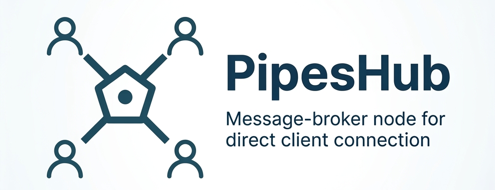

# PipesHub



NodeJS service to make other services communicate through it.

Run the server and derive a class from client. **Clients available in JavaScript, Java and Python**

- JavaScript: [PipesClientJS](https://github.com/ali-heidari/PipesClientJS)
- Python: [PipesClientPython](https://github.com/ali-heidari/PipesClientPython)
- Java: [PipesClientJava](https://github.com/ali-heidari/PipesClientJava)

## Quick overview

PipesHub provides a central hub that other services (clients) connect to. Clients authenticate via a REST API to receive a JWT, then establish a Socket.io connection to exchange messages using one of three modes:

1. request — Invoke an operation on the remote side without expecting a return.
2. ask — Invoke an operation on the remote side and wait for a response.
3. persist — Register to receive incoming messages asynchronously.

## Architecture (simple diagram)

The diagram below shows the high-level flow and components. Connect your clients to any node; the cluster will route and balance messages.

```
 +---------------------+        +------------------+        +--------------------+
 | ClientA / ServicesA | <--->  | Pipeshub Cluster | <---> | ClientB / ServicesB |
 +---------------------+        +------------------+        +--------------------+
                                    ^     ^     ^
                                    |     |     |
                               +----+-----+-----+----+
                               |        REDIS        |
                               |  (token/socketId)   |
                               +---------------------+
```

- Nodes share one Redis: it holds the unit registry, and the Socket.io Redis
  adapter (`@socket.io/redis-adapter`) carries messages between nodes, so a
  unit on one node reaches a unit on any other. Every node needs the same
  `JWT_SECRET` and `REDIS_URL`. A node does not listen until Redis answers.
- Clients first POST to the REST auth endpoint to obtain a JWT.
- Clients then connect to the Socket.io hub with the JWT in the Authorization header.
- Once connected, clients use `request`, `ask`, or `persist` modes to perform communication.

## Run with Docker Compose

The included `docker-compose.yml` runs a **3-node PipesHub cluster** where each node has an embedded [AIxKer](https://github.com/ali-heidari/AION-Agent) agent. AIxKer is an AI-driven L4 load balancer and discovery agent used for demo/self-balancing purposes.

### Requirements

- Linux kernel ≥ 5.4
- Docker with `--privileged` support (needed for eBPF/BPF syscall)

### Start the cluster

```bash
docker compose up -d --build
```

This starts:

| Service | REST (auth) | Socket.io hub | Role |
| --- | --- | --- | --- |
| `pipeshub-1` | `localhost:16916` | `localhost:3000` | Node 1 + AIxKer agent |
| `pipeshub-2` | `localhost:16917` | `localhost:3001` | Node 2 + AIxKer agent |
| `pipeshub-3` | `localhost:16918` | `localhost:3002` | Node 3 + AIxKer agent |
| `mongo` | — | — | Shared unit/user registry |

AIxKer agents discover each other automatically via UDP multicast gossip — no configuration needed. Connect your clients to any node; the cluster self-balances.

### Connect a client

Point your client at any node. Example using the REST auth endpoint on node 1:

```bash
# Get a JWT
curl -X POST http://localhost:16916/auth \
     -d "name=myservice"

# Then connect your Socket.io client to ws://localhost:3000
# with the returned token in the Authorization header (or as auth.token)
```

### Stop the cluster

```bash
docker compose down
```

> Production: For full XDP NIC-bypass performance, deploy one container per physical host using `network_mode: host`. All nodes on the same machine share one NIC, which limits XDP redirect to a single host.

## Run without Docker

```bash
npm ci
JWT_SECRET=$(openssl rand -hex 32) REDIS_URL=redis://127.0.0.1:6379/0 npm start
```

## Configuration

Environment variables:

| Variable | Default | Meaning |
| --- | --- | --- |
| `PORT` | `16916` (`src/configs/config.yaml`) | REST port (`POST /auth`) |
| `SOCKET_PORT` | `3000` | Socket.io port |
| `HTTPS_PORT` | — | HTTPS REST port, used with `SSL_KEY` and `SSL_CERT` |
| `SSL_KEY`, `SSL_CERT` | — | TLS key and certificate files. Used only when both name files that hold a key and a certificate; otherwise the hub serves plain HTTP and logs a warning. |
| `REDIS_URL` | — | Redis URL; else `REDIS_HOST`, `REDIS_PORT`, `REDIS_DB` (localhost:6379/0) |
| `JWT_SECRET` | none: required | Token secret, the same on every node. Without it the hub refuses to start, unless `NODE_ENV=development` (then it uses a random secret). The old public default `pipeshub-default-secret` is refused too. |
| `TOKEN_TTL` | `86400` (24 h) | Token lifetime in seconds; `0` means tokens never expire |
| `AUTH_SECRET` | — | Registration secret. When set, `POST /auth` needs it in the `secret` field for the names in `AUTH_PROTECTED_UNITS`. |
| `AUTH_PROTECTED_UNITS` | `*` when `AUTH_SECRET` is set | Comma-separated unit names that need `AUTH_SECRET`; a trailing `*` matches a prefix, e.g. `world-region-*` |
| `CORS_ORIGINS` | none: same origin only | Comma-separated browser origins allowed to call `POST /auth` and open a socket, e.g. `http://localhost:8080`; `*` allows any. A browser on another origin gets no CORS headers, and its socket handshake is refused (browsers send `Origin` on WebSocket too). Clients that send no `Origin`, such as servers, are not affected. |
| `BIND_ADDR` | `0.0.0.0` (every network) | Address every port listens on, e.g. `127.0.0.1` for this machine only |
| `MAX_HTTP_BUFFER_SIZE` | `1000000` (1 MB) | Largest message a socket may send, in bytes; a bigger one closes the connection |

### Tokens and unit names

- `POST /auth` takes the form fields `name` and, if the name is protected,
  `secret`. It answers with the JWT as plain text, `403` when the secret is
  missing or wrong, and `400` without a name.
- The token names the unit (`sub`). The Socket.io handshake sends it as
  `auth: { token }` or in the `Authorization` header. A `name` in the
  handshake query is optional, but if present it must match the token.
- The hub sets `senderId` on every `gateway` message to the sender's unit
  name, and `receiverId` on every `responseGateway` reply to the unit that
  answered, whatever the client sent.
- One live socket per unit name. A second socket for a live name is refused
  with the connect error `Unit name in use` (`data.code` `UNIT_IN_USE`),
  unless its token proves the same identity: it is the same token (a client
  reconnecting), or it was got with `AUTH_SECRET`. Then the new socket
  replaces the old one: the old socket gets the `gateway` notice
  `Unit name taken over by a new connection.` and is disconnected, and the
  hub logs the takeover. A name is free again once its socket disconnects.

### Events

| Event | Direction | Payload |
| --- | --- | --- |
| `gateway` | hub → unit | `200` once the unit is registered; a message envelope; or a plain-text notice such as `No unit found with given name.` |
| `gateway` | unit → hub | `{ senderId, receiverId, operation, input, awaiting }` |
| `responseGateway` | both | the received envelope plus `res`, back to its sender |
| `gatewayError` | hub → unit | `{ code: 'UNIT_NOT_FOUND', message, event, receiverId, operation, correlationId }` when the target of a `gateway` or `responseGateway` message is unknown or has disconnected. `correlationId` is the message's `input.correlationId` (or `null`). Sent together with the plain-text notice. |
| `subscribePresence` | unit → hub | `'*'` or a list of unit names; the ack is `{ ok: true, online: [...] }` (the named units online now; no list for `'*'`) |
| `unsubscribePresence` | unit → hub | the same, to stop |
| `presence` | hub → unit | `{ unit, status: 'online' \| 'offline', at }`, only to units that subscribed. A takeover is not reported. |

A unit may send as soon as it is connected: messages that arrive before the
hub has registered it wait for that, in order. A unit's Redis entry is
removed when it disconnects.

## Tests

```bash
npm test
```

The tests start their own `redis-server` and hub processes on spare ports
(never 3000 or 16916) and talk to them with real Socket.io clients. They need
`redis-server` on the `PATH`, or `REDIS_SERVER` set to the binary. If a
Lifegrid checkout is found (`LIFEGRID_DIR`, default `../../rust/life-grid`),
they also run Lifegrid's web client (`web/js/pipes.js`) against the hub.

## Standards

This project follows [`ai-agent-standards`](https://github.com/ali-heidari/ai-agent-standards). See [`.agent/agent-instructions.md`](.agent/agent-instructions.md) for project-specific AI agent guidance and instructions.
